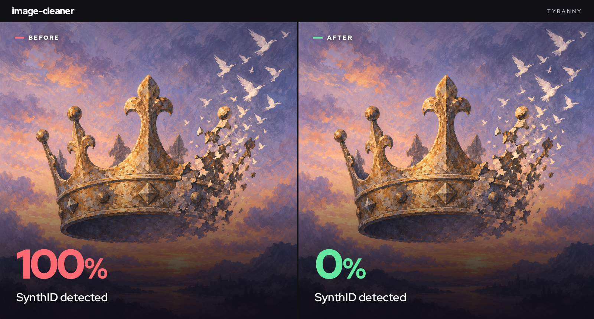

# image-cleaner




Clean a folder of images on your own GPU. Put images in `in/`, run one command, get results in `out/`.

Made by [Tyranny](https://github.com/tyrannyme).

## Quick start

```bash
git clone https://github.com/tyrannyme/image-cleaner.git
cd image-cleaner
./setup.sh      # once
./run.sh        # every time you have new images in in/
```

## Requirements

- Linux with Bash and Git
- Python 3.11 with `venv` and `pip`
- NVIDIA GPU with a driver that supports CUDA 12.8 (no CUDA toolkit needed)
- About 25 GB of free disk space

Tested on an RTX 4070 Ti SUPER (16 GB).

If Python 3.11 is not on your `PATH` as `python3.11`:

```bash
PYTHON=/path/to/python3.11 ./setup.sh
```

## How it works

- Runs CtrlRegen at **strength 0.25, 50 steps**, a deliberately gentle setting.
- Uses [watermarks-remover](https://github.com/guillaumemeyer/watermarks-remover) and [noai-watermark](https://github.com/mertizci/noai-watermark), pinned to fixed commits.
- Everything stays in this folder. Dependencies, model weights, caches, and temp files go in `.tools/`.
- Nothing runs in the background. No server, no daemon, no global config changes.
- Model weights download on the first run and are reused after that.

## Input and output

Folders are mirrored. Outputs are always PNG:

```text
in/portrait.png       -> out/portrait.png
in/album/photo.jpg    -> out/album/photo.jpg.png
```

- **Originals are never changed.** Outputs keep the original dimensions.
- **Already-processed files are skipped.** Delete an output to redo it.
- **Supported formats:** PNG, JPEG, WebP, AVIF, HEIC/HEIF, BMP, GIF, TIFF. Some need extra Pillow codecs; if one is missing, that file fails and is reported.
- **Animated or multipage files** become a single still image.
- **Transparency** is lost; outputs are flattened to RGB.
- **Name clashes:** if two inputs would produce the same output name, nothing runs until you rename one.
- **Failures:** a failed file is reported and the batch continues. The command exits with `1` if any file failed. A failed file never produces an output.

`in/`, `out/`, and `.tools/` are ignored by Git.

## Limits

- **Not guaranteed.** Our test image passed the real detector after processing. That is one example, not a promise for every image.
- **"Done" does not mean "verified."** The script only reports whether processing succeeded. Check important outputs with the real detector.
- **No local score.** A local spectral scorer still flagged our successful output, so it is not included.
- **Details can shift.** Fine detail and colors may change. Look at your outputs before using them.
- **Results vary between runs** because the backend uses random seeds.
- **Strength stays at 0.25.** Strength 0.5 caused severe artifacts in testing, so it is not offered.
